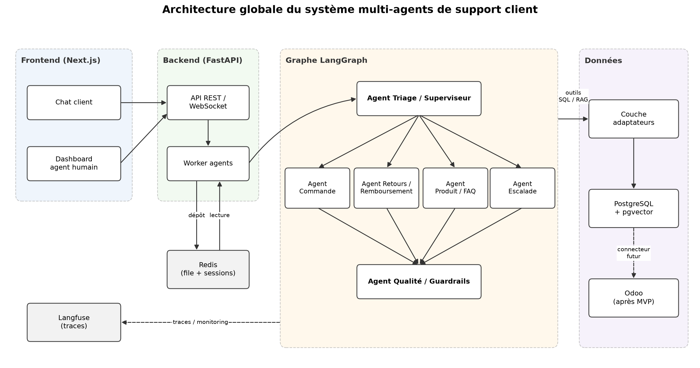
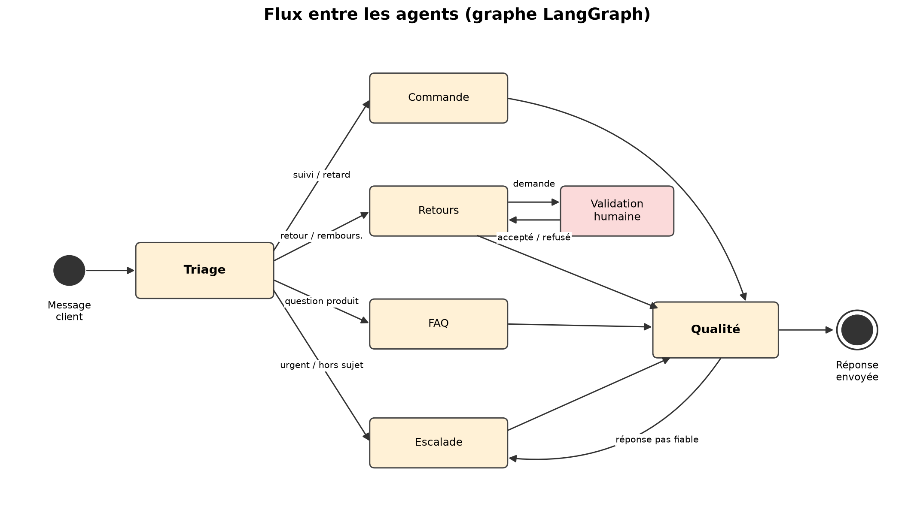
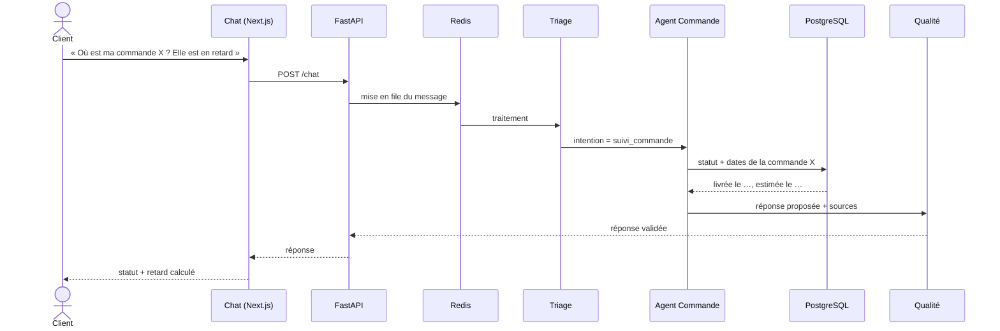
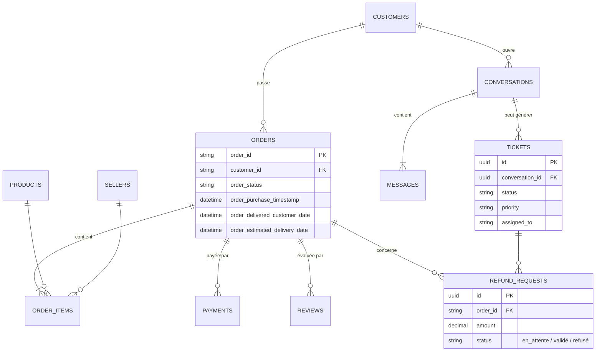

# Architecture – Système multi-agents de support client e-commerce

> Version de cadrage (semaine 1). Ce document évoluera avec le projet.

## 1. Stack technique

| Couche | Technologies |
|---|---|
| Frontend | Next.js, React |
| Backend / API | FastAPI |
| Orchestration des agents | LangGraph (AutoGen en alternative) |
| File de messages et cache | Redis |
| Stockage | PostgreSQL (+ extension pgvector pour le RAG) |
| Évaluation | Ragas, pytest |
| Observabilité | Langfuse |
| Déploiement | Docker, Docker Compose |

## 2. Vue d'ensemble



## 3. Rôle de chaque agent

| Agent | Responsabilité | Outils / données |
|---|---|---|
| **Triage / Superviseur** | Détecte l'intention, la langue, l'urgence et le sentiment, puis oriente vers le bon agent | Classification par LLM |
| **Commande** | Statut de commande, suivi, calcul du retard (date réelle vs date estimée) | Requêtes SQL sur les commandes Olist |
| **Retours & Remboursement** | Vérifie l'éligibilité selon les règles, prépare la demande, attend la validation humaine | RAG sur les règles, `interrupt` LangGraph |
| **Produit / FAQ** | Répond aux questions sur les produits, la livraison et les règles | RAG (pgvector) |
| **Escalade** | Crée un ticket et transfère au support humain (cas complexe, client mécontent, échec) | Table des tickets |
| **Qualité / Guardrails** | Vérifie que la réponse est fondée sur les données, masque les données personnelles | Contrôles avant envoi |

## 4. Flux du graphe LangGraph



## 5. Scénario de référence : « Où est ma commande ? »



## 6. Modèle de données (première version)

Tables issues du dataset Olist, complétées par les tables propres au support :



## 7. Choix techniques justifiés

- **Plateforme from scratch plutôt qu'Odoo :** la stack imposée (Next.js, FastAPI, PostgreSQL) correspond à une plateforme propre. Le module Helpdesk d'Odoo n'existe qu'en version Enterprise. Le développement from scratch permet aussi de maîtriser toute l'architecture et l'évaluation.
- **Couche d'adaptateurs :** les agents n'accèdent jamais directement à la base. Ils passent par des interfaces (`OrderRepository`, `CustomerRepository`…). Un `OdooAdapter` pourra être ajouté après le MVP sans modifier les agents, ce qui ouvre une piste commerciale.
- **LangGraph :** graphe d'états explicite, reprise sur interruption (`interrupt`) pour la validation humaine, intégration avec Langfuse.
- **pgvector :** la recherche vectorielle reste dans PostgreSQL, sans base vectorielle supplémentaire à déployer.
- **Redis :** file d'attente pour traiter les messages de façon asynchrone, et stockage des sessions de conversation.

## 8. Organisation prévue du dépôt

```
backend/      API FastAPI (un dossier par fonctionnalité)
agents/       graphe LangGraph et agents
frontend/     application Next.js
data/         scripts de téléchargement et d'import (données brutes non versionnées)
eval/         jeux de test et évaluation Ragas
docs/         documentation, fiches de suivi
```
